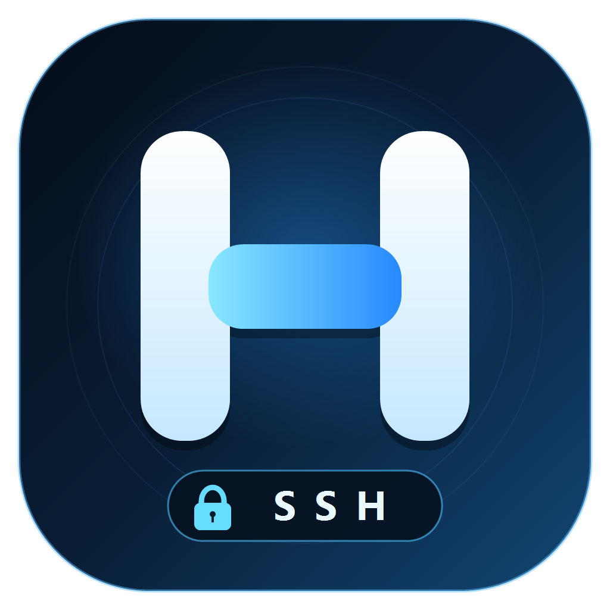
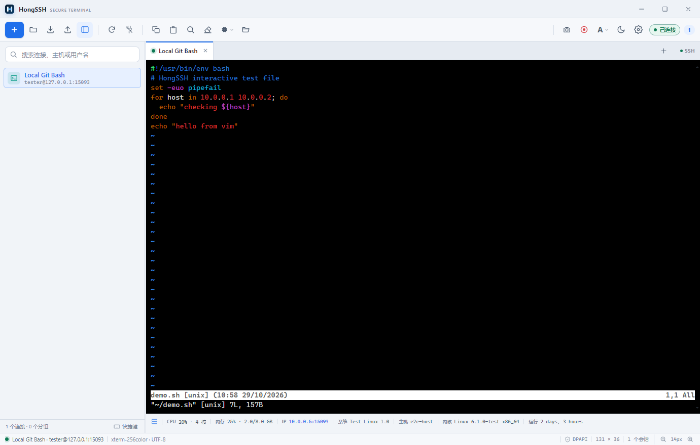
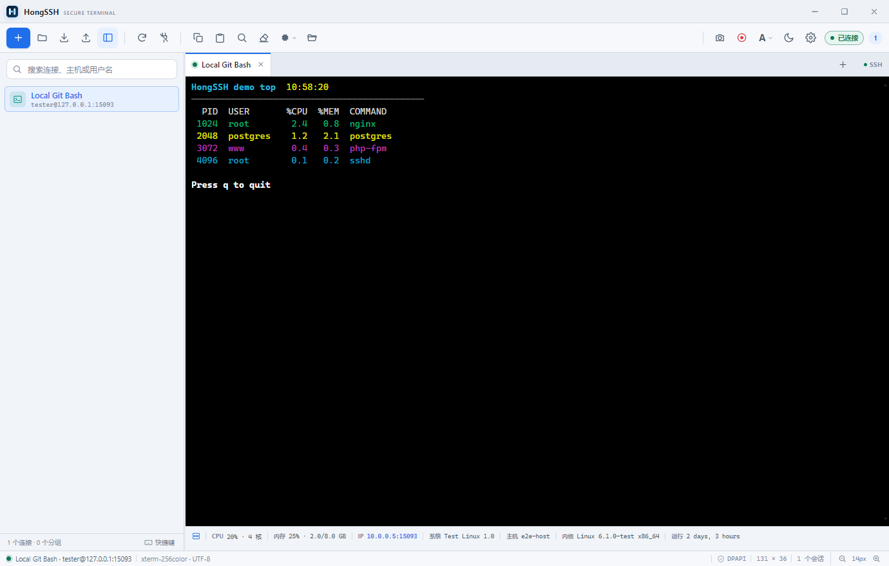
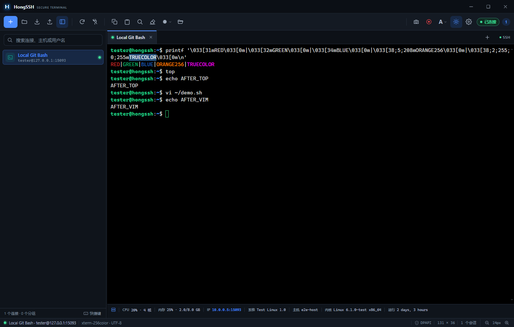
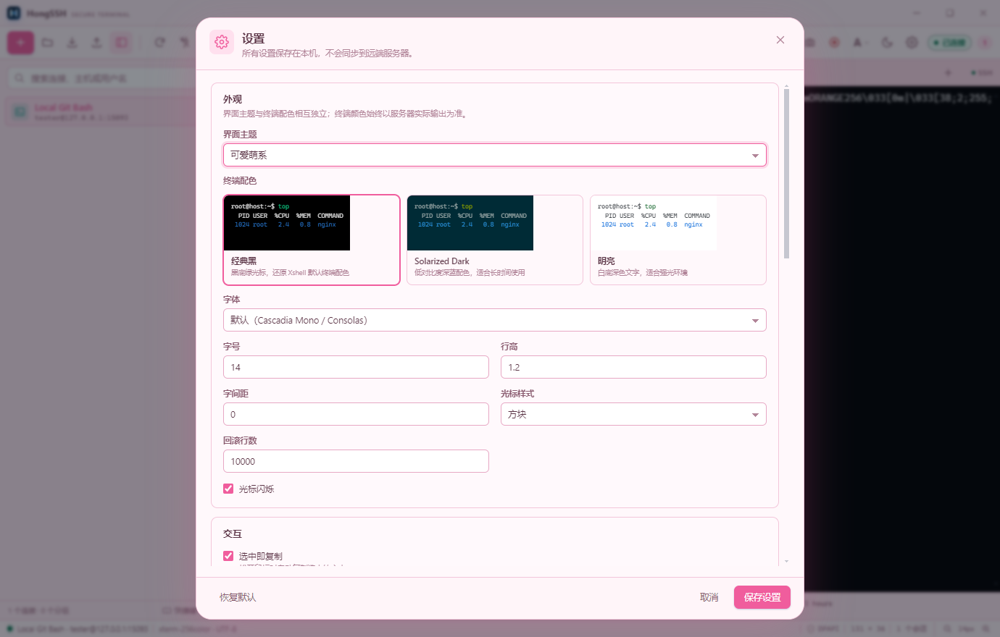
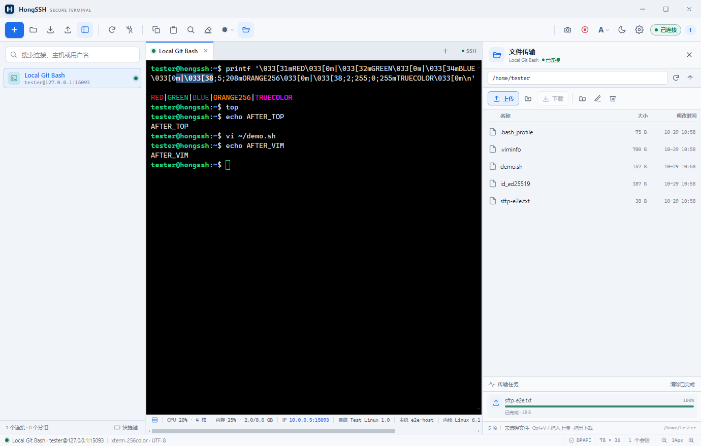
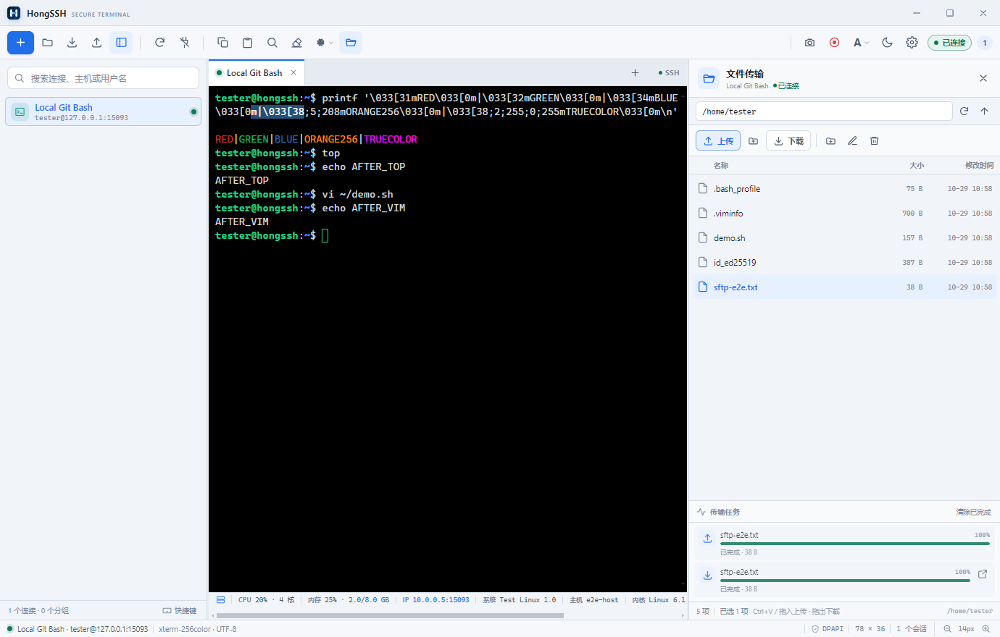
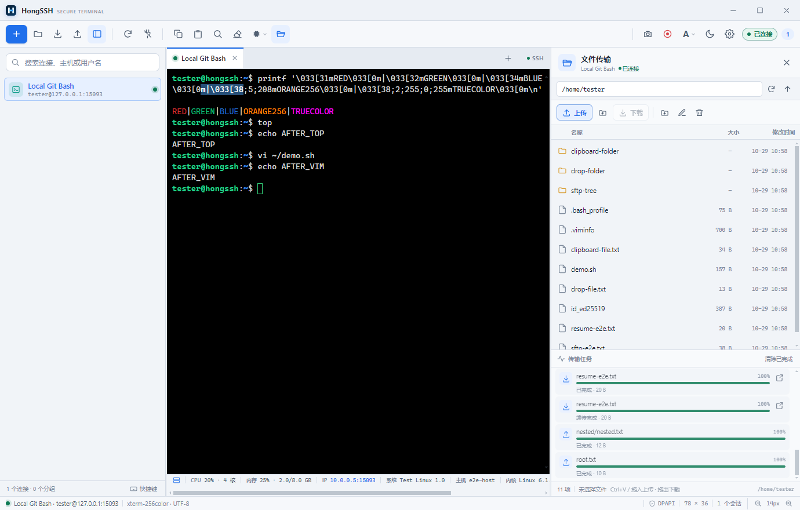
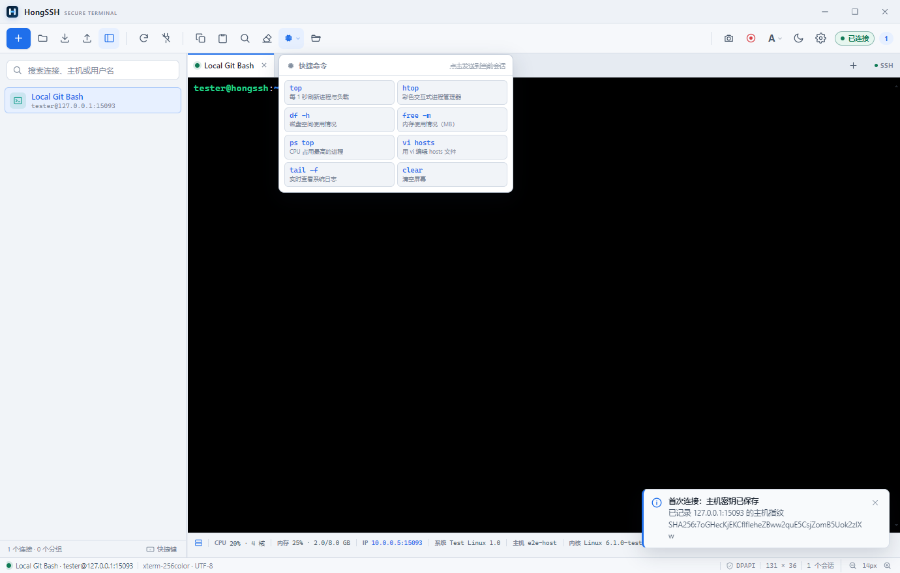

# HongSSH



HongSSH 是一个参考 [HongDBM](../hong-dbm) 的桌面端使用习惯实现的 SSH 终端与文件传输客户端。界面采用连接树 + 多标签页 + 黑色终端工作区，基于 **Electron + xterm.js + ssh2**，通过真实 SSH PTY 通道运行远端 shell，并通过同一 SSH 连接的 SFTP 子系统传输文件。

它不是一个“模拟命令输出”的终端：`top`、`vi`、`htop`、`less`、`tmux` 等全屏程序会由远端服务器真实执行，屏幕上显示的内容、光标位置、ANSI 16 色 / 256 色 / TrueColor 颜色都来自服务器实际返回。



## 功能

- **真实 SSH PTY**：使用 `ssh2` 的 shell channel + `xterm-256color` PTY，支持 `top`、`vi`、`htop`、`less` 等交互式程序，支持窗口尺寸变化（SIGWINCH）。
- **真实终端配色**：xterm.js 解析服务器输出的 SGR 序列，完整保留 16 色、256 色和 24 位真彩色；提供经典黑、Solarized Dark、明亮三套终端配色。
- **无边框自定义窗口**：取消原生标题栏和菜单栏，使用深色/浅色自适应的自定义标题栏、最小化/最大化/关闭按钮，窗口可拖动、双击标题栏切换最大化；首次启动默认 1000×800，窗口大小、位置和最大化状态会在关闭时保存，下次启动按上次关闭时的大小和位置打开。应用默认单实例运行，重复启动会聚焦已有窗口并复用同一个托盘图标。设置、新建连接、确认框、退出确认等所有弹窗都支持拖动标题栏移动位置，并跟随当前界面主题显示。关闭主窗口时隐藏到系统托盘，远程控制继续运行；从托盘菜单选择“退出”时才弹出主题化退出确认，有活动会话时会提示将断开全部连接。
- **Xshell 风格操作**：黑色终端区、底部状态栏、顶部工具栏、多标签会话；双击左侧连接打开，右键打开连接菜单；`Ctrl+Shift+C/V` 复制粘贴，`Ctrl+F` 查找，`Ctrl+Tab` 切换标签。
- **连接树多选拖动**：按住 `Ctrl` 点击可逐个选中/取消分组或连接，按住 `Shift` 点击可按当前可见顺序连续选择锚点到目标之间的节点；选中后可将整批节点拖到目标分组（拖到空白处可移到未分组）。分组行的上/下 1/3 区域用于同级排序，中间区域表示移入该分组；连接可拖到另一个连接的上方或下方调整顺序。拖动靠近树边缘会自动滚动，移动前会显示目标位置并确认，取消不修改，确认后一次性保存。
- **SFTP 文件传输**：在右侧文件面板浏览远端目录，上传文件或整个文件夹、下载文件或文件夹（递归保留目录结构），显示逐文件进度和大小，支持断点续传、新建文件夹、重命名、删除、覆盖确认与取消传输；下载采用 32 路并发分块读取（64 KB/块），并按顺序落盘，在保留断点续传的同时减少高延迟链路的等待。支持从资源管理器拖放文件/文件夹上传，也支持把远端文件/文件夹直接拖到 Windows 资源管理器或桌面下载，复制后按 `Ctrl+V` 也可递归上传到当前目录。文件面板宽度可拖动左侧分隔条调整（也可聚焦分隔条后用方向键，双击或 `Home` 恢复默认），并自动记忆上次宽度。
- **远程桌面（WebRTC 中继）**：默认开启中继，另一台安装了 HongSSH 的 Windows 电脑可通过设备码连接，打开独立的远程桌面窗口；连接时先选择要控制的显示器，支持屏幕画面、鼠标、键盘、全屏和共享文件夹文件传输（断点续传）。
- **WebRTC 公网中继**：默认设备码模式。公网 `relay-server.js` 只交换 SDP/ICE 信令，屏幕、键鼠和文件通过 WebRTC DataChannel 优先 P2P 直连；只有 NAT 打洞失败且配置了 TURN 时才走 TURN 兜底，信令服务器不转发媒体。
- **区域录屏**：顶部工具栏红色圆点按钮可在任意显示器上框选屏幕区域并录制为 WebM；多显示器时所有屏幕同时变暗、可任选一块屏幕框选。框选后可通过八个控制点调整大小或直接拖动选区平移；开始录制后仍可拖动计时条平移录制区域（尺寸保持不变，不能缩放），录制期间显示置顶红框和悬浮计时/停止控制（同样位于选区右下角外侧），支持全局 `Ctrl+Shift+F10` 开始/停止录屏（应用不在前台时也生效）。停止后弹出“另存为”对话框选择文件名和位置；取消对话框时保留到默认的 `HongSSH 录屏` 文件夹（不可写时回退到用户数据目录）。
- **框选截图（Snipaste 风格）**：顶部相机按钮或全局 `Ctrl+Shift+X` 在任意显示器上框选截图（应用不在前台时也生效），蓝色选框带八个控制点和实际像素尺寸标注；支持画笔、荧光笔、矩形、椭圆、箭头、文字、马赛克标注、撤销/重做和颜色切换。画笔、荧光笔和马赛克可设置线条粗细与颜色（马赛克为笔刷线条，另有“无着色”选项），文字可设置字体、字号和颜色；箭头默认样式 4（楔形实心），样式下拉可选择实心 / 开放式 / 空心 / 楔形实心，颜色为两行共 20 个预设色；切换样式时自动设置角度（实心箭头 25°，其余样式 65°），也可用滑块或数字框在 20°–75° 间手动调整，并作用于全部四种箭头样式。选择/移动工具可点选已绘制的箭头、文字、矩形、椭圆、画笔、荧光笔和马赛克标注：拖动可移动位置，箭头两端和矩形/椭圆四角带控制点可调整大小或端点，选中后可直接在工具面板重新调整颜色、线宽、箭头样式/角度、文字字体/字号，双击文字可重新编辑内容。`Enter` / 复制按钮将 PNG 复制到剪贴板，`Ctrl+S` 弹出“另存为”对话框选择 PNG 文件名和位置，也可“贴到屏幕”生成置顶贴图（鼠标移入后右上角显示关闭按钮，双击贴图或按 `Esc` 也可关闭）；取消保存对话框会回到截图编辑器。截图框选层会在应用启动时预热，显示器数量或布局变化时自动重建，点击截图可更快显示。
- **多窗口**：默认允许同时打开多个窗口/实例（重复启动应用即可），便于并排操作多台主机；安装或升级时会自动关闭所有正在运行的 HongSSH 窗口。
- **系统托盘**：关闭主窗口后隐藏到托盘，中继连接、已建立的会话和文件传输继续运行；点击托盘图标恢复主窗口，托盘菜单显示中继状态和已连接控制端数量，并可真正退出应用。
- **系统信息栏**：连接后在终端下方、底部状态栏上方显示 CPU/内存实时使用占比、远端 IP、操作系统、主机名、内核、运行时间、CPU 核数和内存使用情况；CPU 与内存占比每 1 秒刷新，所有信息保持单行，窗口较窄时在信息栏底部显示横向滚动条；通过独立 SSH exec 通道采集，不会污染终端输出。
- **工具栏状态**：工具栏按钮支持启用/禁用/选中状态，侧栏、文件传输、深色模式按钮会高亮；右侧状态胶囊显示“未连接 / 连接中 / 已连接 / 重连中 / 异常”。右上角“A”菜单提供小/中/大三档字号（14/16/18px），与底部状态栏的缩放按钮同步；字体缩放按钮位于底部状态栏右下角。
- **连接管理**：分组树、搜索、新建/编辑/复制/删除连接、拖拽调整侧栏宽度、最近连接、连接保活、登录后自动执行命令；选中分组后新建连接会自动归入该分组。连接树滚动条默认隐藏，仅保留滚轮滚动，可在设置中重新显示。
- **认证方式**：密码、OpenSSH/PEM 私钥（支持私钥口令）、Windows Pageant / SSH Agent。
- **密码安全存储**：连接密码和私钥口令通过 Electron `safeStorage`（Windows DPAPI）加密后保存在 `%APPDATA%\HongSSH\secrets.json`，连接配置文件不包含明文密码。
- **主机密钥校验**：首次连接记录 SHA256 指纹；默认 `accept-new`，指纹变化时阻止连接；支持严格模式和宽松模式，可在设置中查看/删除已信任主机。
- **配置导入/导出**：可导入 HongSSH 配置文件夹，也兼容解压后的 Xshell `Sessions` 目录，按原文件夹结构导入分组和连接并自动去重；导出为 `HongSSH-配置-<时间戳>/` 目录，包含分组、连接、登录密码和私钥口令，导入后自动用系统安全存储重新加密。**导出目录包含明文密码，请妥善保管。**
- **快捷命令**：快捷命令按钮位于文件传输按钮左侧，点击后下拉显示 `top`、`htop`、`df -h`、`free -m`、`ps`、`vi`、`tail -f` 等常用命令，一键发送到当前会话。
- **主机巡检**：工具栏“主机巡检”按钮位于文件传输按钮左侧，弹窗中可勾选磁盘空间巡检并调整告警阈值（默认 90%，范围 1–100%，调整后自动保存），一次巡检所有已配置的 SSH 连接；通过 `df` 检查每个挂载点使用率，按连接列出告警、正常、失败状态以及告警挂载点、使用率和容量，可按状态筛选。已打开的会话直接复用，无需重复输入密码；巡检过程实时显示进度，可随时停止。
- **界面主题**：内置 21 套界面主题：默认、扁平化、拟物风、手绘涂鸦风、水彩水墨风、像素风、新拟态、赛博朋克、深色模式、纸张卡片、可爱萌系、极简主义、瑞士平面、荧光高亮、金属拉丝、木纹竹质、布料毛绒、暗黑哥特、清新森系、奢华高贵、护眼模式；终端配色独立，支持字体、字号、行高、字间距、光标、回滚行数等设置。








## 技术架构

```text
Electron 主进程 (desktop/)
   ├─ store.js           连接、分组、设置、DPAPI 加密凭据、已知主机
   ├─ ssh-manager.js     ssh2 Client / shell PTY / resize / 主机密钥 / 重连
   ├─ inspection.js      df 输出解析与磁盘巡检阈值
   ├─ sftp.js            SFTP 目录浏览、上传下载、进度、取消、覆盖检查
   ├─ xshell-import.js   Xshell JSON 会话扫描与分组映射
   ├─ xshell-export.js   Xshell Sessions 目录结构与 JSON 导出
   ├─ preload.js         最小化 contextBridge API
   └─ main.js            无边框窗口、IPC、窗口状态

渲染进程 (src/)
   ├─ terminal/session.ts  xterm.js、Fit/Search/WebLinks/Unicode11、复制粘贴
   ├─ terminal/manager.ts  多标签会话管理
   ├─ ui/sftp-panel.ts     右侧 SFTP 文件浏览器与传输队列
   ├─ ui/                  侧栏、标题栏、工具栏、状态栏、弹窗、Toast、右键菜单
   └─ main.ts              应用控制器
```

- 渲染进程开启 `contextIsolation`、`sandbox`，不注入 Node.js；SSH 连接、文件读取和凭据只在主进程完成。
- 终端数据通过 IPC 按 sessionId 流式传输；主进程用 `StringDecoder` 处理跨 chunk 的 UTF-8 多字节字符。
- 终端尺寸变化会通过 `stream.setWindow(rows, cols)` 同步到远端 PTY。

## 开发环境

- Windows 10/11 x64
- Node.js 20+（开发与构建）
- 可选：Git Bash（仅本地 E2E 测试服务器需要，见下文）

```powershell
# 安装依赖
npm install

# 开发模式：Vite + Electron
npm run dev

# 构建前端并启动
npm start

# 已安装依赖时也可以直接双击 start.cmd 启动

# 仅构建前端
npm run build

# 类型检查
npm run typecheck
```

## 打包安装文件

```powershell
# 生成 Windows x64 安装包和便携版
npm run dist

# 只生成解包目录，方便本地检查
npm run dist:dir
```

也可以直接双击项目根目录的 `package.bat`：脚本会检查 Node.js/npm、按需安装依赖、构建前端并打包，完成后可选择打开 `release/` 目录；失败时会停留以便查看原因。

产物在 `release/`：

```text
release/
├─ HongSSH-1.0.0-setup.exe        NSIS 安装程序
├─ HongSSH-1.0.0-portable.exe     免安装便携版
├─ HongSSH-1.0.0-setup.exe.blockmap
└─ win-unpacked/                  未压缩的运行目录
```

## Code signing policy

正式发布的安装包与便携版由 GitHub Actions 从公开源码构建，签名由 [SignPath.io](https://about.signpath.io) 提供、证书由 [SignPath Foundation](https://signpath.org) 持有：

**Free code signing provided by [SignPath.io](https://about.signpath.io), certificate by [SignPath Foundation](https://signpath.org).**

团队职责、签名流程、签名验证方法与隐私声明见 [docs/code-signing.md](docs/code-signing.md)。

安装程序是**按用户安装**（无需管理员权限），支持选择安装目录、创建桌面和开始菜单快捷方式。启动安装程序时会自动关闭所有正在运行的 `HongSSH.exe` 窗口，再替换文件，避免多开窗口占用文件导致升级失败；不需要手动退出应用。远程控制只通过 WebRTC 中继工作，不监听本地端口，也不需要配置 Windows 防火墙。当前安装包没有购买代码签名证书，Windows SmartScreen 可能提示“未知发布者”；点击“更多信息 → 仍要运行”即可。应用图标为深蓝色圆角方块中的 H 字母、安全锁和 SSH 标识，位于 `desktop/assets/icon.ico`，打包配置在 `package.json` 的 `build` 字段中；修改图标后可运行 `powershell -ExecutionPolicy Bypass -File scripts/make-icon.ps1` 重新生成 PNG/ICO。

> 安装包和 `release/` 构建产物不进入 Git，需在本地执行上面的命令生成。
>
> 首次构建时 electron-builder 需要解压 `winCodeSign` 工具包；如果 Windows 没有开启开发者模式并提示 `Cannot create symbolic link`，请以管理员身份运行一次 `npm run dist`（或开启 Windows 开发者模式），之后会复用缓存。

> Electron 二进制默认从 GitHub 下载。如果网络受限，可以先设置镜像：
>
> ```powershell
> $env:ELECTRON_MIRROR = "https://npmmirror.com/mirrors/electron/"
> npm install
> ```

首次启动会在 `%APPDATA%\HongSSH` 创建：

```text
data.json      连接、分组、设置、已知主机
secrets.json   DPAPI 加密后的密码 / 私钥口令
window-state.json
logs/hongssh.log
```

## 使用说明

### 新建连接

1. 点击左上角“新建连接”或按 `Ctrl+N`，先选择 **SSH 终端** 或 **Windows 远程桌面**；如果侧栏已选中某个分组，新连接会自动带入该分组。
2. 选择 SSH 终端时，填写主机、端口、用户名，并选择密码 / 私钥 / SSH Agent。
3. 选择 Windows 远程桌面时，填写对方设备码。
4. 可选填写登录后自动执行命令，例如 `cd /data/app && ls`（仅 SSH）。
5. 点击“测试连接”验证网络与认证，然后“保存并连接”。

新建分组：点击工具栏的文件夹按钮（会作为当前选中分组的子分组），或在连接树空白处右键选择“新建分组”。

首次连接会弹出密码框（如果未保存密码），并记录服务器主机指纹。导入 HongSSH 配置时会同时恢复已保存的密码；直接导入 Xshell 原始会话时，其机器绑定密码仍无法迁移，首次连接输入一次即可。

### 导入配置

1. 选择 HongSSH 导出的配置文件夹，或解压后的 Xshell `.rar` / `Sessions` 文件夹。
2. 点击工具栏“导入配置”按钮（或在连接树空白处右键选择导入）。
3. HongSSH 会按原目录结构创建分组；重复连接会被跳过。
4. HongSSH 配置中的密码会恢复到系统安全存储中；Xshell 原始会话的加密密码仍需首次连接时输入。

### 导出配置

1. 点击工具栏的“导出配置”按钮（向上箭头图标）。
2. 选择导出位置；HongSSH 会创建 `HongSSH-配置-<时间戳>/` 目录。
3. 导出结果保留分组和 `*_connect_config.json` 文件结构，并额外写入 `hongssh_password` / `hongssh_passphrase` 字段，可直接备份或重新导入 HongSSH。
4. 导出目录中包含明文密码，请勿上传到公共位置；导入后会使用 Windows DPAPI 重新加密保存。

### 文件上传 / 下载

1. 连接并打开一个会话后，点击工具栏的文件夹按钮，或按 `Ctrl+Shift+E`，打开右侧“文件传输”面板。
2. 面板默认进入远端主目录，可通过路径栏、向上的“上一级”按钮导航；双击文件夹进入。
3. 点击“上传”选择一个或多个本地文件；点击旁边的文件夹按钮可递归上传整个文件夹（保留嵌套目录和空目录）。
4. 选中一个或多个远端文件/文件夹，点击“下载”，选择本地保存目录；文件夹会递归下载并保留目录结构。
5. 目标位置已有同名文件时会弹出覆盖确认；传输任务区域显示每个文件的进度、完成/失败状态，进行中的任务可取消。
6. 在 Windows 资源管理器中复制文件或文件夹，点击文件面板获得焦点后按 `Ctrl+V`，会按原文件名/原目录结构递归上传到当前远端目录。
7. 也可以直接从资源管理器把文件或文件夹拖到文件面板；拖入时显示虚线高亮区域，松手后递归上传到当前目录。
8. 反向操作：在文件面板选中一个或多个远端文件/文件夹，把它们拖到 Windows 资源管理器、桌面或任意本地文件夹，松手后按原名称直接下载到该目录；若目标已存在同名文件/文件夹，会提示是否覆盖，选择取消则中止下载且不修改现有内容。
9. 面板还支持新建远端文件夹、重命名、删除（文件夹可递归删除，删除前会提示包含的内容）和右键复制远端路径。

断点续传是自动的：

- 上传和下载都会把未完成数据保存在目标文件旁的 `.hongssh.part` 文件；失败、取消或应用关闭后重新发起同一路径的传输，会从已有大小继续。
- 传输面板会显示“续传中 / 续传完成”。
- 如果用户明确确认覆盖一个已存在的完整目标文件，且存在同路径断点，仍会优先续传；只有没有断点时才从头开始。
- 断点续传根据文件大小衔接；如果源文件在中断期间发生变化，建议删除 `.hongssh.part` 后重新传输。

SFTP 复用当前终端会话的 SSH 连接（同一个 `ssh2 Client`），不会重复登录；打开文件面板不会中断正在运行的终端程序。







### 远程桌面（WebRTC 中继）

1. **被控电脑**：保持 HongSSH 运行即可，默认开启远程控制和中继；关闭主窗口会隐藏到托盘并保持中继在线，只有从托盘菜单“退出 HongSSH”才会停止。
2. **中继**：设置 → 远程控制（WebRTC 中继）默认已启用，但**需要填写你自己部署的中继地址和 HOST_TOKEN**（程序不内置公共中继），设备码自动生成；不监听本地端口，也不需要配置防火墙。
3. **控制电脑**：在左侧连接树空白处或分组上右键，选择“新建远程桌面连接”，或点击“新建连接”后选择“Windows 远程桌面”，填写对方设备码；双击该连接会打开独立的远程桌面窗口。
4. **画面与流量**：远程连接里可配置画面质量（40/55/62/75/85）和刷新间隔（100/125/150/200/250/300/500 毫秒，默认 200ms）。画面静止时不发送图像；只有鼠标移动时只发送归一化坐标（约 30 次/秒）；画面局部变化时只发送按 16px 对齐的脏矩形 JPEG，变化面积过大才发送全屏。远程光标使用普通箭头，不再显示圆形标记。
5. 连接成功后，如果对方有多块屏幕，会先弹出“选择要控制的屏幕”，选择后才开始传输画面和接管键鼠；之后右上角的下拉框可随时切换屏幕，键鼠坐标会自动映射到所选屏幕。
6. **文件传输**：点击远程窗口右上角“文件”，打开共享文件夹面板。共享目录固定为对方 `%USERPROFILE%\\Downloads\\HongSSH`；可上传本地文件或下载远端文件，失败/关闭后重新传输会从 `.part` 文件已有大小继续。
7. **网络与安全**：连接使用 WebRTC 加密，中继服务器只交换信令，正常连接时画面和文件走 P2P，不经过服务器；设备码是连接入口，请勿公开。

> 当前版本远程桌面只保留 WebRTC 中继，不再提供 IP + 端口直连；支持多显示器选择、键鼠和共享文件夹传输；暂不支持剪贴板同步、音频、锁屏/UAC 安全桌面控制。

### WebRTC 公网中继（自行部署）

适合被控端没有公网 IP、无法做端口映射的场景。中继服务器只做设备注册和 SDP/ICE 信令交换，正常直连时画面和文件不经过服务器。

HongSSH **不内置任何公共中继地址**。请自行准备一台有公网 IP 的服务器，部署根目录的 [relay-server.js](relay-server.js)，然后把地址和 token 填到“设置 → 远程控制（WebRTC 中继）”：

```text
wss://relay.example.com
HOST_TOKEN=<你自己生成的随机串>
```

1. 公网服务器运行 [relay-server.js](relay-server.js)，配置 `HOST_TOKEN`、`PORT`、`ICE_SERVERS_JSON`；公网访问建议套一层 TLS 并使用 `wss://`。新服务器可直接用 [deploy-relay.sh](deploy-relay.sh) 一键部署，详细说明见 [relay-server-README.md](relay-server-README.md)。
2. 被控端打开“设置 → 远程控制（WebRTC 中继）”，填写上面两个值，并确认本机设备码。
3. 控制端新建远程桌面连接时，填写**相同的中继地址**和对方设备码即可。
4. 能打洞时 WebRTC 走 P2P；对称 NAT 打洞失败时，如果信令服务配置了 TURN，才走 TURN 兜底。没有 TURN 时不会把画面转发到信令服务器。

> `HOST_TOKEN` 是主机注册凭据，不是访问密码；设备码本身是唯一连接入口，请勿公开。请使用足够随机的 token，并且不要把它提交到版本库。

### 区域录屏

1. 点击顶部工具栏右侧的红色圆点“区域录屏”按钮；
2. 所有显示器会同时变暗，在任意一块屏幕上拖动鼠标框选要录制的区域（选区不能跨屏），尺寸和“重选 / 取消 / 开始录制”按钮显示在红框右下角外侧；框选后拖动八个控制点可调整大小，直接拖动选区可平移；按“开始录制”或 `Enter`；
3. 录制开始后，选区外侧保持一圈置顶红框，计时/停止条位于红框右下角外侧；**按住计时条拖动可平移录制区域**（尺寸固定，不能缩放）；点击“停止”或按 `Ctrl+Shift+F10` 结束；
4. 点击“停止”或按 `Ctrl+Shift+F10` 结束，随后弹出“另存为”对话框选择文件名和保存位置；取消对话框时会保留到默认的 `HongSSH 录屏` 文件夹（安装目录不可写时回退到用户数据目录），格式为 WebM。

录制只包含画面，不包含麦克风/系统声音；`Esc` 可取消框选。框选期间主窗口仍保持打开，录屏可以包含主窗口、终端或远程桌面窗口中的任意区域。

### 框选截图

1. 点击顶部工具栏的相机按钮，或按 `Ctrl+Shift+X`；
2. 所有显示器会同时变暗，拖动框选要截图的区域（选区不能跨屏）；拖动八个蓝色控制点可调整范围，左上角蓝色徽标显示实际像素尺寸；
3. 工具栏显示在选区右下角外侧：点击画笔、荧光笔、马赛克、箭头或文字工具，会在对应按钮下方展开设置面板——画笔/荧光笔/马赛克可调线条粗细和颜色（马赛克为笔刷线条，可选无着色），文字可调字体、字号和颜色，箭头默认样式 4（楔形实心），可通过下拉框切换实心/开放式/空心/楔形实心样式，切换样式时自动设角度（实心 25°，其余 65°），也可用滑块或数字框在 20°–75° 间调整，再选择 20 个预设颜色；矩形/椭圆工具点击后也可选择颜色。使用选择/移动工具点击已有标注可选中，拖动移动；箭头两端、矩形/椭圆四角可拖动调整，选中后可直接修改上述参数，双击文字可重新编辑内容；`Delete` 删除选中标注，`Ctrl+Z` / `Ctrl+Y` 撤销/重做，选择后直接拖动画标注；
4. 按 `Enter` 或点击复制按钮复制到剪贴板；`Ctrl+S` 或保存按钮会弹出“另存为”对话框，选择 PNG 文件名和位置，取消对话框可继续编辑；“贴到屏幕”会生成一个置顶贴图，双击贴图关闭；
5. `Esc` 取消截图，所有屏幕的遮罩会一起关闭。

### 常用命令
顶部工具栏“快捷命令”按钮位于“巡检”按钮左侧，会在当前会话已连接时启用，点击后才展开命令按钮。点击 `top` 发送 `top -d 1`（每 1 秒刷新），`vi hosts` 发送 `vi /etc/hosts`，`tail -f` 发送日志跟踪命令。也可以直接在黑色终端中键入任意命令。



### 主机巡检

1. 点击工具栏“主机巡检”按钮（位于文件传输按钮左侧）。
2. 勾选“磁盘空间使用率”，在右侧设置告警阈值（默认 90%）。阈值改变后会自动保存，下次打开继续使用。
3. 点击“开始巡检”。HongSSH 会检查所有已配置的 SSH 连接：已打开的会话复用当前 SSH 连接，未打开的会话使用已保存的密码或私钥登录。
4. 巡检结果会实时出现，并汇总告警主机数量；点击“告警 / 正常 / 失败”卡片可筛选连接。告警行会显示具体挂载点、使用率和已用容量。
5. 巡检期间可点击“停止”；未保存密码且尚未打开会话的主机会显示失败原因，先手动连接并勾选“记住密码”即可参与后续巡检。

> 巡检只执行只读的 `df -P -k` 命令，不会修改远端文件；远程桌面连接不参与磁盘巡检。

### 复制 / 粘贴

- 鼠标选中文本后，默认“选中即复制”。
- `Ctrl+Shift+C` 复制、`Ctrl+Shift+V` 粘贴。
- 右键默认打开终端菜单，可复制当前选择、复制并粘贴到光标位置、粘贴多行指令（按剪贴板中的实际换行逐行粘贴，只有内容包含换行时才发送回车）、全选、查找、清屏；可在设置中改为右键直接粘贴或忽略。
- 终端内 `Ctrl+C` 会原样发送 `SIGINT`，不会被应用截获。

## 快捷键

| 功能 | 快捷键 |
| --- | --- |
| 新建连接 | `Ctrl+N` |
| 关闭当前会话 | `Ctrl+W` |
| 下一个 / 上一个标签页 | `Ctrl+Tab` / `Ctrl+Shift+Tab` |
| 复制 / 粘贴 | `Ctrl+Shift+C` / `Ctrl+Shift+V` |
| 在终端中查找 | `Ctrl+F` |
| 全选终端内容 | `Ctrl+Shift+A` |
| 放大 / 缩小 / 重置字体 | `Ctrl+=` / `Ctrl+-` / `Ctrl+0` |
| 显示 / 隐藏连接面板 | `Ctrl+B` |
| 文件传输面板 | `Ctrl+Shift+E` |
| 框选截图 | `Ctrl+Shift+X`（全局） |
| 开始 / 停止录屏 | `Ctrl+Shift+F10`（全局） |
| 重新连接 | `Ctrl+R` |
| 设置 | `Ctrl+,` |
| 全屏 | `F11` |
| 快捷键帮助 | `F1` |

## 安全说明

- 渲染进程没有 Node.js 权限，所有 SSH 和文件操作通过白名单 IPC 完成。
- 密码不会回传给渲染进程；编辑连接时输入框只显示占位提示，留空表示保持原密码。
- 密码与私钥口令使用 Windows DPAPI（Electron `safeStorage`）加密后落盘；如果系统不支持，应用会禁用“记住密码”，只在内存中使用。
- 主机密钥首次连接自动记录；后续指纹不一致会拒绝连接（默认策略），避免中间人攻击。
- 远程桌面使用 WebRTC 加密通道；中继服务器只交换信令，不转发正常 P2P 媒体。
- 远程桌面只通过 WebRTC 中继工作，不监听本地端口；关闭主窗口会隐藏到托盘并保持中继在线，从托盘菜单退出后才停止；设备码是唯一连接入口。
- 导出的配置文件包含明文密码，请妥善保管；不保存 SSH 会话内容到磁盘。
- 终端中打开的 http/https 链接会交给系统浏览器，不会在应用内导航。

## 测试

```powershell
# 单元测试：Xshell 导入/导出、拖放下载占位文件与落点识别
npm test

# E2E：启动 Electron + 本地 SSH 测试服务器，验证真实 PTY、top、vi、颜色、搜索、缩放
npm run test:e2e
```

安装器多窗口测试（Windows）：

1. 同时启动 3 个 `HongSSH.exe` 窗口；
2. 运行 `HongSSH-1.0.0-setup.exe /S /D=<临时目录>`；
3. 验证 3 个旧进程全部退出、安装文件完整、安装后的应用能启动。

本次发布已自动连续执行 3 轮，全部通过。

用户提供的 `ssh.rar` 样本包含 39 个 Xshell 会话；已验证可导入为 39 个连接（8 个分组），再导出为 39 个 `*_connect_config.json` 文件，导出后再导入不会产生重复连接。

E2E 测试服务器：

- 需要 Windows + Git Bash（默认路径 `C:\Program Files\Git\bin\bash.exe`）。
- 使用 `ssh2` 启动 SSH Server 并实现 SFTP 子系统，用 `node-pty` 的 ConPTY 启动真实 Git Bash；不是 mock shell。
- 用户名 `tester`，密码 `test123`，端口随机；测试结束后自动清理。
- 截图输出到 `docs/screenshots/`。

也可以单独启动测试服务器：

```powershell
npm run test:ssh
# HongSSH test SSH server ready: ssh tester@127.0.0.1 -p 2222
```

测试覆盖：

- 读取真实 SSH PTY，`window-change` 改变列数；
- 密码登录与 OpenSSH 私钥登录；
- SGR 31/32/34（16 色）、`38;5;208`（256 色）、`38;2;255;0;255`（TrueColor）在 xterm buffer 中的实际前景色；
- `top` 全屏程序、单键 `q` 退出；
- `vi` 打开文件、`:q!` 退出；
- `Ctrl+F` 查找、设置弹窗、深色主题；
- 21 套界面主题逐一切换并恢复默认；
- 无边框自定义标题栏、最大化/还原、原生菜单移除、快捷键仍然有效；
- 弹窗标题栏拖动；
- 工具栏连接状态胶囊、侧栏/文件/主题按钮选中状态；
- 连接树滚动条默认隐藏，设置中可切换显示；
- 连接后系统信息栏显示 CPU/内存实时占比（位于 IP 前面）、IP、OS、主机名、内核、运行时间、CPU 和内存；内容不换行，过宽时底部横向滚动；
- 字体缩放位于右下角状态栏；
- 文件传输右侧快捷命令下拉菜单；
- 选中分组后点击新建连接，新建对话框自动带入分组；
- Xshell 导入、导出与再导入去重；
- SFTP 面板目录浏览、真实文件上传/下载、递归文件夹上传/下载、空目录保留、传输进度、断点续传、远端新建目录、非空文件夹递归删除；
- 从 Windows 剪贴板复制文件/文件夹后，在 SFTP 面板按 `Ctrl+V` 递归上传；
- 从资源管理器拖放文件/文件夹到 SFTP 面板上传，带拖入高亮提示；
- 把远端文件/文件夹从 SFTP 面板拖到资源管理器/桌面下载，拖动时显示真实文件名和文件夹/文件类型预览，使用原名称，同名时提示覆盖或取消；
- 渲染进程无 console/page error。

项目还使用用户提供的 Rocky Linux 10 测试主机做过人工验证：`top`、`vi`、`Ctrl+C`、256 色/TrueColor 输出、窗口 resize，以及 SFTP 上传/下载和 `r+` 断点续传写入均正常。真实主机地址与凭据不会写入仓库。

## 目录

```text
hong-ssh/
├─ desktop/                 Electron 主进程与 SSH 后端
│  ├─ sftp.js               SFTP 浏览、上传、下载、进度与取消
│  ├─ xshell-export.js      Xshell Sessions 目录结构与 JSON 导出
│  ├─ installer.nsh          NSIS 安装前关闭所有 HongSSH 窗口
├─ src/                     渲染进程（TypeScript）
│  ├─ terminal/             xterm.js 会话、标签管理、终端主题
│  ├─ ui/                   侧栏、标题栏、工具栏、状态栏、文件面板、弹窗、Toast
│  └─ dialogs/              连接、密码、设置、导入结果等弹窗
├─ tests/
│  ├─ unit/                 Node 单元测试
│  ├─ ssh-server.mjs        本地 SSH + ConPTY 测试服务器
│  ├─ e2e.mjs               Electron E2E
│  └─ fixtures/bin/top      测试用全屏 top
├─ docs/screenshots/        界面截图
├─ index.html
├─ vite.config.ts
└─ package.json
```

## 已知限制

- 目前仅支持 UTF-8 终端编码；GBK 远端需要在服务器侧设置 UTF-8 locale。
- SFTP 支持文件夹递归上传/下载和断点续传；单次最多 2000 个文件、目录层级最多 64 层，递归时会跳过符号链接。
- 拖出下载使用临时占位文件和文件系统监听识别 Windows 资源管理器的落点；压缩包内部、虚拟目录等不理解普通文件拖放的目标可能无法识别，可改用“下载”按钮。
- 拖出下载遇到同名目标会提示覆盖或取消；选择取消不会修改现有文件，选择覆盖同名文件夹会先删除目标文件夹再下载。
- 断点续传按文件大小衔接，不校验内容哈希；如果中断期间源文件变化，建议删除 `.hongssh.part` 后重新传输。
- 不支持 PuTTY `.ppk` 私钥（请用 PuTTYgen 转为 OpenSSH 格式），不支持端口转发、跳板机/ProxyJump。
- Xshell 原始会话的加密密码受本机账户绑定限制，不能迁移；HongSSH 自己导出的配置可以恢复密码。
- 终端鼠标上报（鼠标点击/滚轮上报给远端 vim/tmux）仅支持 xterm SGR 模式；普通滚轮用于本地回滚。
- 远程桌面只保留 WebRTC 中继，需要中继服务器在线；不再支持 IP + 端口直连。
- 远程桌面支持主屏和多显示器切换；暂不支持剪贴板同步、音频、锁屏/UAC 安全桌面。
- 远程文件传输只针对对方 `Downloads\\HongSSH` 共享文件夹，不支持任意目录浏览；断点按文件大小衔接，不校验哈希。
- 远程桌面窗口是独立窗口，不占用主窗口的会话标签页。
- 目前只在 Windows 上验证；Electron 主进程代码使用 Node 标准 API，其他平台需自行适配 `safeStorage` 和 SSH Agent。

## 统一更新中心

HongSSH 已接入 `hong-app-update` 统一更新服务：

- 应用启动后自动检查更新，之后每 6 小时检查一次；托盘菜单“检查更新…”和“关于 HongSSH”弹窗里的“检查更新”可手动触发。
- 管理端在“升级管理”中把指定版本下发给指定安装实例，客户端领取任务后下载安装包、校验 SHA-256，并以 `/S` 静默运行 NSIS 安装器。
- 客户端自动上报机器唯一标识、Windows 登录用户、本地 IP、当前版本和安装目录；业务用户 ID 可为空。
- 服务地址默认 `http://127.0.0.1:9188`，可用 `HONG_UPDATE_SERVER` 覆盖；调试状态写入数据目录的 `update-state.json`。
- 更新实现：`desktop/app-update.js`；安装器关闭逻辑：`desktop/installer.nsh`。

## License

MIT
